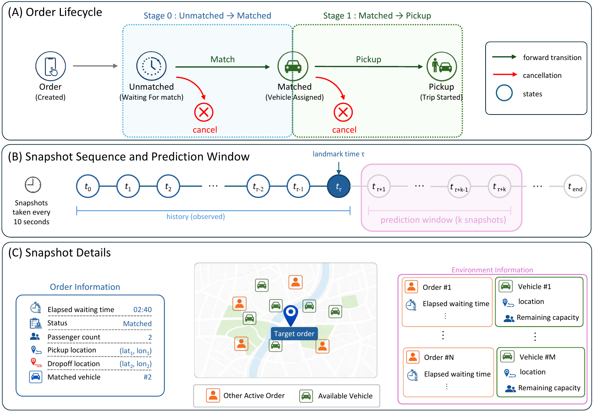

<h1 align="center">SurvCancel</h1>

<h3 align="center">A Longitudinal Dataset and Benchmark for Dynamic Order Cancellation Prediction in On-Demand Ride-Sharing Systems</h3>

<p align="center"><b>NeurIPS 2026 Evaluations &amp; Datasets Track</b></p>

<p align="center">
  Huayang Liu<sup>*</sup>, Mingyu Zheng<sup>*</sup>, Wei Zhang<sup>†</sup>, Yijun Bian, and Kai Wang<br>
  <em>Tsinghua University &amp; University of Copenhagen</em><br>
  <sub><sup>*</sup> Equal contribution &nbsp;&nbsp; <sup>†</sup> Corresponding author</sub>
</p>

<p align="center">
  <a href="https://tsingtransit.github.io/survcancel/"></a>
  <a href="https://huggingface.co/datasets/survcancel-anonymous/SurvCancel"></a>
  <a href="#quickstart"></a>
  <a href="https://github.com/tsingtransit/survcancel/stargazers"></a>
</p>

<p align="center">Real-world order histories for benchmarking dynamic cancellation risk.</p>

<p align="center">
  <a href="#overview">Overview</a> &nbsp;&nbsp;
  <a href="#baselines">Baselines</a> &nbsp;&nbsp;
  <a href="#quickstart">Quickstart</a> &nbsp;&nbsp;
  <a href="#experiments">Experiments</a> &nbsp;&nbsp;
  <a href="#outputs">Results</a> &nbsp;&nbsp;
  <a href="#citation">Citation</a>
</p>

---

<a name="overview"></a>

## ✨ Overview

| Orders | Snapshots | Service regions | Snapshot interval |
|:------:|:---------:|:---------------:|:-----------------:|
| **173,037** | **7,944,171** | **4** | **10 seconds** |

**SurvCancel** is a large-scale longitudinal dataset and benchmark for real-time, order-level cancellation prediction in on-demand ride-sharing systems. Built from operational logs across four service regions (`R1`–`R4`), it contains **173,037 released orders** and **7,944,171 snapshots** sampled at 10-second intervals along each order's pre-pickup trajectory—capturing both order-level lifecycle states and the surrounding supply-demand context (nearby active requests and available vehicles).

We formulate cancellation prediction as a **stage-conditioned dynamic survival task**:

- **Stage 0 (Pre-matching, 60 s default horizon):** At landmark time $\tau$, cancellation competes with vehicle assignment (`match`).
- **Stage 1 (Post-matching, 30 s default horizon):** At landmark time $\tau$, cancellation competes with passenger pickup (`pickup`).

To support standardized comparison across model families, this repository provides:

- **Clean58 preprocessing:** Deterministic extraction of 58 standardized snapshot features, order-level splits, and fixed evaluation landmarks from the raw JSONL release.
- **Evaluation protocols:** In-distribution (`id`), leave-one-region-out (`loro_R1`–`loro_R4`), global chronological (`chrono_global`), and within-region chronological (`chrono_R1`–`chrono_R4`) splits across five prediction-window settings.
- **Seven baselines:** Classical survival models (`Landmark Cox`, `RSF`), neural competing-risk models (`DeepHit`, `DynDeepHit`, `SurvTRACE`, `TraCeR`), and our lightweight history-pooling baseline (`RiskPool`), plus a plug-and-play interface for custom models.

<p align="center">
  <a href="https://tsingtransit.github.io/survcancel/#overview"></a>
</p>

<p align="center"><em>Observe an order's history up to the current landmark and predict cancellation within its stage-specific future window.</em></p>

---

<a name="baselines"></a>

## 🧠 Baselines

All models share the Clean58 input representation, order-level splits, and fixed evaluation landmarks. Use the CLI key with `benchmark.sh --models` to select a model.

| Model | CLI key | Model family |
|-------|---------|--------------|
| **RiskPool (ours)** | `riskpool` | Lightweight history pooling |
| [DeepHit](https://doi.org/10.1609/aaai.v32i1.11842) | `deephit` | Neural competing-risk survival model |
| [Dynamic-DeepHit](https://doi.org/10.1109/TBME.2019.2909027) | `dyn_deephit` | Recurrent dynamic survival model |
| [SurvTRACE](https://doi.org/10.1145/3535508.3545521) | `survtrace` | Transformer-based survival model |
| [TraCeR](https://arxiv.org/abs/2512.18129) | `tracer` | Longitudinal competing-risk Transformer |
| [Landmark Cox](https://doi.org/10.1111/j.2517-6161.1972.tb00899.x) | `cox` | Cox regression at prediction landmarks |
| [Random Survival Forests](https://doi.org/10.1214/08-AOAS169) | `rsf` | Ensemble survival trees |

Model configurations are in [configs/models/](configs/models/). To add your own model, start with [examples/custom_model.py](examples/custom_model.py).

---

<a name="quickstart"></a>

## 🚀 Quickstart

### 1. Environment Setup

Run the following commands from the repository root (requires Python 3.11):

```bash
conda create -n survcancel python=3.11 -y
conda activate survcancel
python -m pip install -r requirements.txt
```

### 2. Download the Dataset

Download the released JSONL shards (`train-R1.jsonl` through `train-R4.jsonl`, revision `51ab808`) from [Hugging Face](https://huggingface.co/datasets/survcancel-anonymous/SurvCancel):

```bash
bash scripts/download_data.sh
```

By default, files are saved to `data/hf_survcancel_release/`. To specify a custom target directory:

```bash
bash scripts/download_data.sh survcancel-anonymous/SurvCancel /path/to/raw-data
```

### 3. Prepare `Clean58` and Evaluation Protocols

Stream the raw JSONL shards into the shared `Clean58` sequence tensor (`120 × 58` per order), generate order-level train/validation/test partitions, and fix evaluation landmarks (seed `42`):

```bash
bash scripts/prepare_clean58.sh data/hf_survcancel_release workdir
```

By default, this prepares all evaluation protocols (`id`, `loro_R1`–`loro_R4`, `chrono_global`, and `chrono_R1`–`chrono_R4`) and all five Stage 0 / Stage 1 prediction windows (`60/30`, `60/60`, `120/60`, `300/180`, and `600/300` seconds):

```text
workdir/
  processed/dynamic_order_sequences_clean58.npz
  protocols/
    id/
    loro_R1/ ... loro_R4/
    chrono_global/
    chrono_R1/ ... chrono_R4/
  PREPARATION.json
```

If you only need the default in-distribution (`id`, `60/30` s) benchmark:

```bash
bash scripts/prepare_clean58.sh data/hf_survcancel_release workdir \
  --protocols id --windows h060_030
```

---

<a name="experiments"></a>

## 🔬 Running Experiments

### Reproduce Paper Results

To run the full experimental suite reported in the paper and supplementary material:

```bash
./reproduce.sh --workdir workdir --device cuda:0
```

You can also run specific experiment groups via `--experiments`:

| Experiment group | Evaluation | Models |
|------------------|------------|--------|
| `main` | In-distribution benchmark | All seven baselines |
| `shifts` | Leave-one-region-out across R1–R4 and global chronological split | RiskPool, DynDeepHit, TraCeR, RSF |
| `regional` | Within-region chronological evaluation | DynDeepHit, TraCeR |
| `representation` | History and feature-masking sensitivity | RiskPool |
| `horizons` | Prediction windows of 60/30, 60/60, 120/60, 300/180, and 600/300 seconds | RiskPool, DynDeepHit |
| `distances` | RBF MMD and 1D Wasserstein diagnostics | Clean58 covariates |
| `inference` | Single-request latency and batched throughput | RiskPool, DynDeepHit |

Use `--dry-run` to inspect the execution plan without launching training, or `--resume` to skip completed runs and resume interrupted checkpoints.

### Benchmark Selected or Custom Models

Use `benchmark.sh` to evaluate specific built-in models (`deephit`, `dyn_deephit`, `survtrace`, `tracer`, `cox`, `rsf`, `riskpool`) on any prepared protocol and window:

```bash
./benchmark.sh --workdir workdir --models riskpool dyn_deephit --device cuda:0
```

To evaluate your own model under the exact same splits, landmarks, and metrics, implement a Python class with `fit(train_loader, val_loader)` and `predict_batch(batch)` returning `{"p_cancel_window": probs}` (see [`examples/custom_model.py`](examples/custom_model.py) for a minimal working example):

```bash
./benchmark.sh --workdir workdir \
  --custom-model examples/custom_model.py:Model \
  --model-name logistic --device cpu
```

---

<a name="outputs"></a>

## 📊 Outputs and Evaluation Metrics

Results are written to `outputs/reproducibility/` (for `reproduce.sh`) or `outputs/benchmark/` (for `benchmark.sh`). Each experiment directory contains:

| Output | Contents |
|--------|----------|
| `summary.csv` and `summary.json` | Mean and sample SD across training seeds 42, 123, and 456 |
| `per_seed.csv` | Per-seed scores overall, by stage, by region, and by region–stage group |
| `<model>_s<seed>/` | Saved configuration, checkpoint, validation/test predictions, and run logs |

Metrics include cancel-window C-index, Brier score, AUROC, AP, log loss, 10-bin adaptive ECE, mean predicted risk, and aggregate calibration gap. Scores are reported for both raw predictions and validation-fitted stage-wise Platt scaling.

Browse the [main benchmark and generalization results](https://tsingtransit.github.io/survcancel/#experiments) on the project page.

---

## 📚 Repository Structure

```text
survcancel/
  benchmark.sh              # Entry point for built-in or custom model evaluation
  reproduce.sh              # Entry point for reproducing all paper experiments
  requirements.txt          # Pinned Python 3.11 dependencies
  configs/                  # Hyperparameter configs for models and feature masks
  scripts/                  # Data download, Clean58 preparation, and model trainers
  survbench/                # Core library: dataset loaders, models, metrics, calibration
  survcancel_benchmark/      # CLI orchestration, shift diagnostics, and reporting
  examples/custom_model.py  # Template for plugging in custom models
  docs/                     # Static project page
```

---

<a name="citation"></a>

## 📝 Citation

If you find SurvCancel useful in your research, please cite our paper:

```bibtex
@inproceedings{liu2026survcancel,
  title     = {SurvCancel: A Longitudinal Dataset and Benchmark for Dynamic Order Cancellation Prediction in On-Demand Ride-Sharing Systems},
  author    = {Liu, Huayang and Zheng, Mingyu and Zhang, Wei and Bian, Yijun and Wang, Kai},
  booktitle = {Advances in Neural Information Processing Systems (NeurIPS), Evaluations and Datasets Track},
  year      = {2026}
}
```
